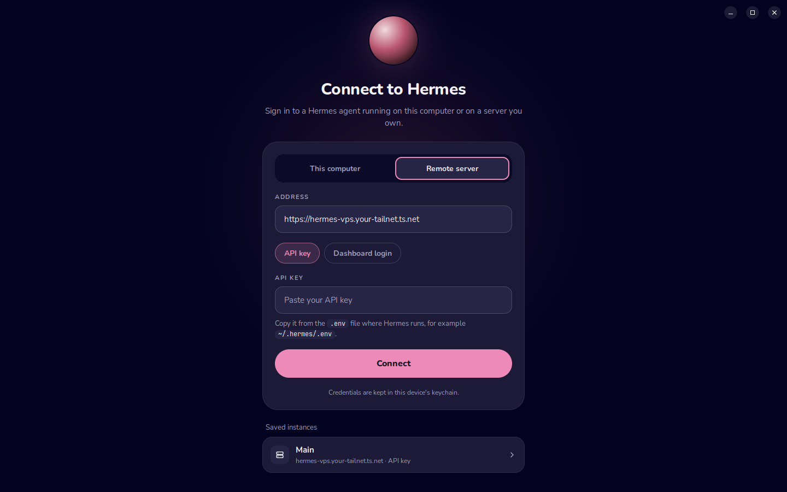
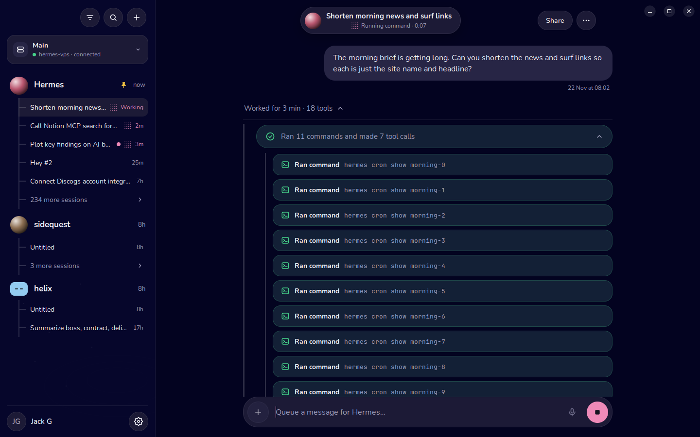
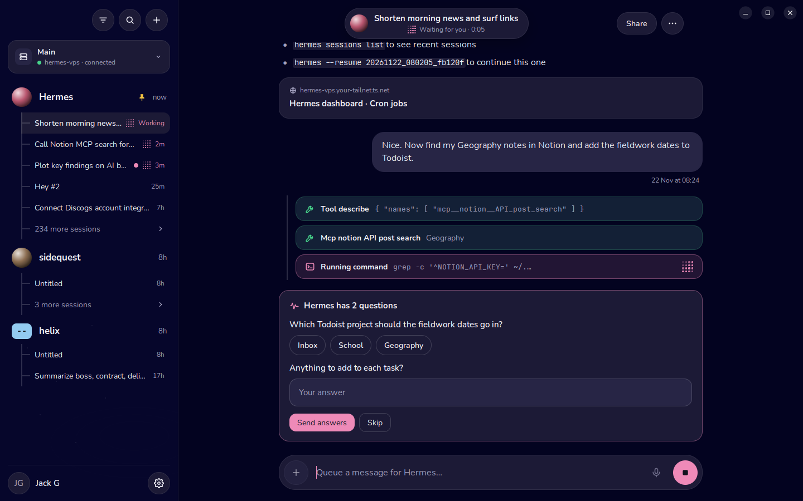
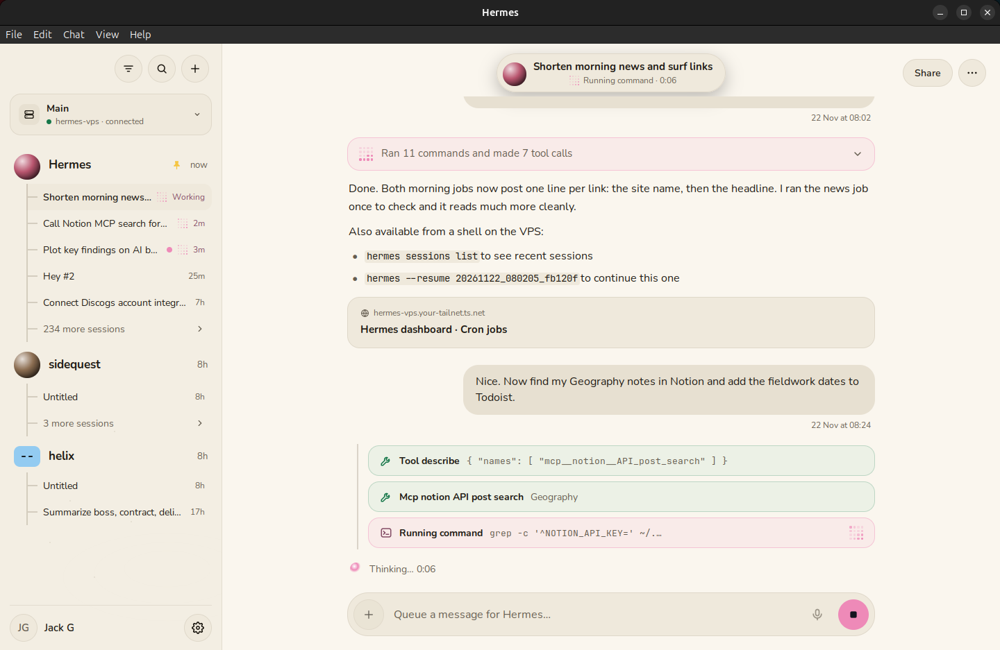

<p align="center"></p>

<h1 align="center">Hermes Desktop</h1>

<p align="center">A fast, native desktop app for <a href="https://github.com/NousResearch/hermes-agent">Hermes Agent</a>, on macOS, Windows and Linux.</p>


Hermes Desktop connects to a Hermes Agent instance, on your computer or on a
server you own, and gives each of its agents a home: every chat in a sidebar
you can jump through from the keyboard, replies that stream in as they are
written, the agent's tool calls as it makes them, and its questions and
approvals as cards you answer in place.

It is written in Go and drawn by [MyGo](https://github.com/egoist/mygo)'s
GPU UI: no browser engine, no Electron. It opens in about a quarter of a
second, switches chats in a few milliseconds, and keeps a local copy of your
chats so it never waits on the network to show you what you had.

## Contents

- [Install](#install)
- [Sign in](#sign-in)
- [Using it](#using-it)
- [Keyboard](#keyboard)
- [Settings](#settings)
- [Your data](#your-data)
- [Develop](#develop)
- [License](#license)

## Install

**macOS and Linux**

```sh
curl -fsSL https://raw.githubusercontent.com/j4ckxyz/hermes-desktop-mygo/main/install.sh | sh
```

**Windows**, in PowerShell

```powershell
irm https://raw.githubusercontent.com/j4ckxyz/hermes-desktop-mygo/main/install.ps1 | iex
```

Either one installs the latest release for you alone, without administrator
rights:

- macOS: in `/Applications`, or `~/Applications` if you can't write to
  `/Applications`.
- Linux: in `~/.local`, with the `hermes-desktop` command and a menu entry.
- Windows: in `%LOCALAPPDATA%\Programs\Hermes`.

Before installing, the scripts check what they download against the
release: on macOS and Linux, the Ed25519 signature of the app's update key;
on Windows, the installer's SHA-256.

Run the command again to update. To uninstall:

- macOS and Linux: `sh install.sh --uninstall`. Your settings stay.
- Windows: remove it from **Settings → Apps**.

Installing this way also avoids the warnings macOS and Windows show for apps
from developers without a paid certificate. Those warnings are for files a
browser marks as downloaded, and the scripts mark nothing. The builds are
signed ad hoc, not by Apple or Microsoft.

The [releases](../../releases) have the same builds to download by hand:

- macOS: a disk image for both Apple silicon and Intel Macs.
- Windows: an installer and a portable `.exe`, for x64 and Arm.
- Linux: a `.deb` and a `.tar.gz`, for amd64 and arm64.

A disk image downloaded in a browser needs right-click → **Open** the first
time, or `xattr -dr com.apple.quarantine /Applications/Hermes.app`. On
Windows, choose **More info → Run anyway**.

Linux needs GTK 3 and libepoxy, which desktops already have. Staying signed
in needs libsecret and a Secret Service (GNOME Keyring or KWallet).
Hermes Desktop shows no web pages, so it doesn't need WebKitGTK.

### Updates

Hermes Desktop updates itself from the releases here.

- **At launch:** if a newer version is out, it shows a page with what's new
  before anything else.
  - **Update and reopen** downloads the new version, checks it was signed
    with Hermes Desktop's key, replaces the app and reopens it. It comes
    back on the same instance and chat, with anything you hadn't sent still
    in the message box.
  - **Not now** leaves it until another day.
- **While it runs:** it checks every six hours. A new version downloads
  quietly, then a **Restart to update** toast appears.
- **Settings → Updates** shows the version you have and the download's
  progress. It has **Check now**, and a switch to turn automatic updates
  off.

Some copies can't update themselves, and the Updates pane says so:

- Development builds.
- A copy installed from the `.deb`. Install a newer `.deb` instead, or
  use the install script.

### Build it yourself

You need Go 1.27.3 or later. Any OS can build for every OS:

```sh
git clone https://github.com/j4ckxyz/hermes-desktop-mygo && cd hermes-desktop-mygo
make build          # bin/hermes-desktop for this machine
make cross          # dist/: macOS, Windows and Linux, amd64 and arm64
go tool mygo build  # build/: the packaged app, as a release has it
```

## Sign in



The first time it opens, Hermes Desktop asks where your Hermes runs:

1. **This computer** or **Remote server.** For this computer, leave the
   address empty and it finds the dashboard on its usual ports (9119, 9120).
   For a server, enter its address, for example
   `https://hermes.your-tailnet.ts.net`.
2. **How to sign in**, either way:
   - **API key**: the value of `HERMES_DASHBOARD_SESSION_TOKEN` in the
     `.env` where Hermes runs (`~/.hermes/.env`). On *This computer* the app
     can read it for you. If your instance has no such line, add one (any
     long random string, for example `openssl rand -hex 32`) and restart
     `hermes dashboard` or `hermes gateway`; until then the app tells you the
     instance does not accept API keys.
   - **Dashboard login**: the username and password you use for the Hermes
     web dashboard (`dashboard.basic_auth` in its `config.yaml`). The app
     exchanges them for tokens and refreshes them as they expire.
3. **Connect.** The app checks the address and the credentials, then opens
   your agents. Credentials go into your system's keychain (macOS Keychain,
   Windows Credential Manager, the Secret Service on Linux) and nowhere
   else. On a Linux system with no keychain they are kept in memory only,
   and you sign in again next time.

Add more instances from the instance card at the top of the sidebar
(**Add instance…**), and switch between them there. **Settings →
Instances** signs one in again or removes it.

## Using it

- **Agents and chats.** Each agent (a Hermes profile) has its chats under
  it, newest first, with the last day's on show and the rest behind
  "N more sessions". A grid of dots marks a chat the agent is working in; a
  dot marks one with news you have not read. Click an agent to fold it.
- **Chat.** Type in the box at the bottom and press **Enter** (Shift+Enter
  for a new line). Replies stream in as Markdown. The agent's work stays out
  of the way: while it runs, one line says what it is doing ("Running
  command… 0:42 · 3 tools"); once it is done, the line reads "Worked for 3
  min, 36 secs · 18 tools". Click the line to see its reasoning and its tool
  calls ("Ran 11 commands and made 7 tool calls", which opens to each
  command), and click a call to see its result. Messages typed while the
  agent is busy queue behind its current work.
  
- **Stop.** The pink button in the message box, or **Esc**.
- **Questions and approvals.** When the agent needs you, a card appears in
  the chat: an approval for a risky command, a question or a batch of them,
  a sudo password or a secret it needs. Answer there, or skip. Passwords and
  secrets go straight to your instance and are not kept.
  
- **Right-click** anything: an agent (new chat, pin), a chat (rename, pin,
  copy its ID or its `hermes --resume` command, export as Markdown, delete),
  a message (copy), a tool call (copy the command or its result), a link.
- **Share** exports the open chat as Markdown.
- **Menus.** On macOS they are in the menu bar at the top of the screen. On
  Windows and Linux the app draws its own title bar, as on macOS, so its
  menus stay out of sight until you press **Alt** or **F10**.
- **Search** (**Ctrl/⌘+K**) finds chats by title at once, and by their text
  on your instance a moment later.
- **Notifications.** With the window in the background, the app tells you
  when an agent finishes or needs you, with a soft chime if Sounds is on.
  Clicking one brings the window forward on that chat. (Approvals are
  answered in the chat: the notifications have no buttons of their own.)

## Keyboard

| Keys (⌘ on macOS, Ctrl on Windows and Linux) | Does |
|---|---|
| ⌘1 … ⌘9 | Open the 1st … 9th chat shown in the sidebar |
| Hold ⌘ | Show those numbers on the chats |
| ⌘N | New chat with the current agent |
| ⌘K | Search chats |
| ⌘, | Settings |
| Esc | Stop the agent (or close search, or leave settings) |
| Enter / Shift+Enter | Send / new line |
| ⌘⇧E | Export the chat as Markdown |
| Alt or F10 (Windows, Linux) | Open the menus (File, Edit, Chat, View, Help) |
| F2 | Rename (from a chat's menu) |

## Settings


**Look & Feel** changes the whole app as you choose, and remembers it:

- **Appearance**: follow the system, or stay light or dark, with a **light
  canvas** (White, Paper White) and a **dark canvas** (Midnight, Black,
  Gray) for each.
- **Accent colour**: ten, from Blue to Rainbow.
- **Font and text size**: rounded (the default), system, serif or mono, in
  seven sizes; the first follows your system's text size.
- **Loading indicator**: fifteen, in three families: marching grids,
  spheres of light and spheres of mist.
- **Characters** (agents' orbs breathe, and bob while working), **sounds**,
  **background artwork** and a **translucent sidebar** (macOS, and Windows
  11 with Mica).
- **App icon**: the marble comes in each accent colour; the window,
  taskbar and Dock icons change with it.




Other pages: **General** (link previews, the shortcuts), **Instances**,
**Agents & profiles** (pin agents to the top), **Notifications**,
**Permissions**, **Terminal & SSH** and **Updates**.

## Your data

| What | Where |
|---|---|
| Passwords, API keys, sign-in tokens | The system keychain only |
| Settings (`settings.json`) and saved instances (`instances.json`, addresses only) | `~/.config/Hermes Desktop` (Linux), `~/Library/Application Support/Hermes Desktop` (macOS), `%AppData%\Hermes Desktop` (Windows) |
| A cache of your agents, chats and the 300 transcripts you opened most recently (`cache.db`, SQLite) | The system cache folder, `Hermes Desktop` |

The cache only makes the app fast. Deleting it loses nothing your instance
doesn't also have.

**The cache holds the text of your chats unencrypted.** It's readable by
your user account and by anyone who can read your files: what you sent,
the agents' replies, and their tool output. It keeps the 300 transcripts
you opened most recently and removes the rest after each sync. To clear it,
remove the instance in **Settings → Instances**, which deletes its cache, or
delete `cache.db` while the app is closed. Use full-disk encryption
(FileVault, BitLocker, LUKS) if that matters on your machine. Link cards fetch the title of the page they point to, once,
without cookies, and only from public addresses: never your own machine or
network (loopback, private, link-local and CGNAT ranges, checked on every
redirect), except your instance's own address. Turn that off in **Settings →
General → Load link previews**.

## Develop

```sh
make check        # go vet (all build tags) + go test -race ./...
make build        # bin/hermes-desktop
make cross        # dist/: macOS, Windows, Linux × amd64/arm64, from any OS
make demo         # the app against an in-process fake instance (design data)
make screenshots  # each screen of the demo build, on a private Xvfb
make bench        # launch, chat switching and streaming numbers
make icon         # draw the app icon to assets/ and resources/
tools/update-test.sh  # install an old build, publish a newer one locally, update
```

Linux needs GTK 3, Pango, cairo and libepoxy, and Xvfb for headless runs.
The live end-to-end test runs against your own instance: put `HERMES_URL`
and either `HERMES_USERNAME`/`HERMES_PASSWORD` or `HERMES_API_KEY` in
`.env.local` (gitignored), then
`go test -tags live -run Live -v ./internal/hermes/`. It deletes the chat it
creates.

### Releasing

To release a version:

1. Set a new `version` in `mygo.json`.
2. Describe its changes under a heading of that number in `CHANGELOG.md`.
3. Push to `main`.

`.github/workflows/release.yml` then builds and publishes the release:

- The apps for every platform, with their installers.
- The updates that installed copies fetch. These are signed with the key in
  the repository's `MYGO_UPDATER_PRIVATE_KEY` secret.

Installed apps accept only updates signed with that key, so keep a copy of
it somewhere safe. If the key is lost, no installed copy can update again.

Three workflows check each release on real macOS, Windows and Linux
machines:

- `ci.yml`: the tests.
- `install-test.yml`: the install commands above, run against the latest
  release.
- `update-test.yml`: an installed copy replacing itself with a newer one,
  then reopening by itself.

| Path | What |
|---|---|
| `cmd/hermes-desktop` | the app: window, native menus, dialogs, notifications |
| `internal/hermes` | the Hermes client: REST, sign-in (API key, dashboard login), JSON-RPC socket |
| `internal/transcript` | stored messages and live events → turns, tool-call labels |
| `internal/core` | app state, sync, cache-first loading; all I/O off the UI thread |
| `internal/views` | the MyGo views: connect, sidebar, chat, settings, search |
| `internal/appicon` | the marble icon, drawn in code in every colour |
| `internal/cache`, `internal/secrets` | SQLite cache (pure Go), OS keychain |
| `internal/theme`, `internal/settings` | design tokens, persisted Look & Feel |
| `design/` | the design export the app follows |
| `docs/` | the [Hermes API](docs/hermes-api.md) and [MyGo](docs/mygo-notes.md) notes, [benchmarks](docs/benchmarks.md), the [design comparison](docs/design-comparison.md) |

## License

[MIT](LICENSE). Hermes Agent is a separate project by Nous Research, under
its own licence.
