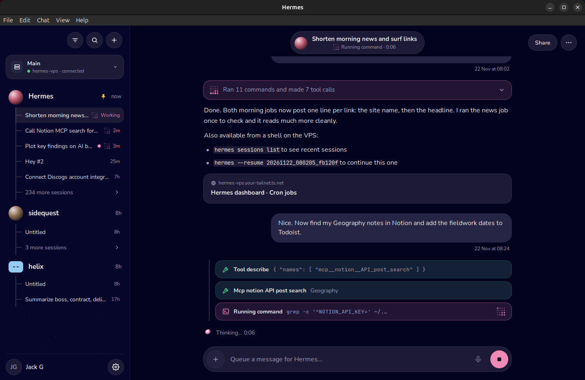
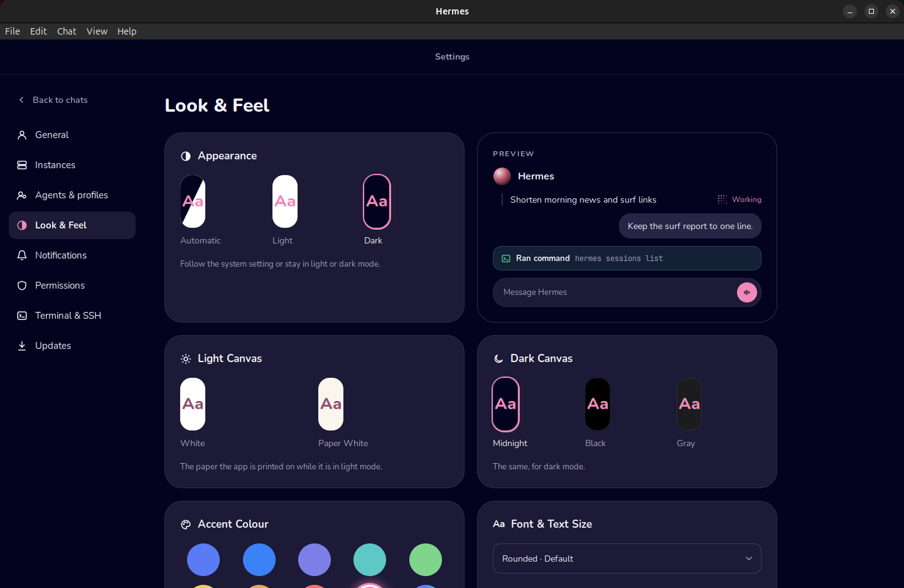

<p align="center"></p>

<h1 align="center">Hermes Desktop</h1>

<p align="center">A fast, native desktop app for <a href="https://github.com/NousResearch/hermes-agent">Hermes Agent</a>, on macOS, Windows and Linux.</p>



Hermes Desktop connects to a Hermes Agent instance, on your computer or on a
server you own, and gives each of its agents a home: every chat in a sidebar
you can jump through from the keyboard, replies that stream in as they are
written, the agent's tool calls as it makes them, and its questions and
approvals as cards you answer in place.

It is written in Go and drawn by [MyGo](https://github.com/egoist/mygo)'s
GPU UI: no browser engine, no Electron. It opens in about a quarter of a
second, switches chats in a few milliseconds, and keeps a local copy of your
chats so it never waits on the network to show you what you had.

## Contents

- [Install](#install)
- [Sign in](#sign-in)
- [Using it](#using-it)
- [Keyboard](#keyboard)
- [Settings](#settings)
- [Your data](#your-data)
- [Develop](#develop)

## Install

There are no signed release builds yet. Build it from source (any OS can
build for every OS):

```sh
git clone https://github.com/j4ckxyz/hermes-desktop-mygo && cd hermes-desktop-mygo
make build          # bin/hermes-desktop for this machine
make cross          # dist/: macOS, Windows and Linux, amd64 and arm64
```

You need Go 1.27.3 or later. Every CI run also uploads the six builds as an
artifact (Actions → the run → *hermes-desktop-…*).

- **Linux:** `scripts/install-linux.sh` installs the app for your user
  (`~/.local/bin`, a menu entry and the icon); open **Hermes** from your app
  menu. It needs GTK 3, Pango, cairo and libepoxy, which every desktop has.
  Keeping signed-in credentials needs a Secret Service (GNOME Keyring or
  KWallet). `scripts/install-linux.sh --uninstall` removes it.
- **macOS:** run `dist/hermes-desktop-darwin-arm64` (Apple silicon) or
  `-amd64` (Intel). The binary is not signed yet, so macOS asks you to allow
  it in **System Settings → Privacy & Security** the first time.
- **Windows:** run `dist/hermes-desktop-windows-amd64.exe` (or `-arm64`).
  SmartScreen may ask you to confirm, as the build is not signed yet.

## Sign in


The first time it opens, Hermes Desktop asks where your Hermes runs:

1. **This computer** or **Remote server.** For this computer, leave the
   address empty and it finds the dashboard on its usual ports (9119, 9120).
   For a server, enter its address, for example
   `https://hermes.your-tailnet.ts.net`.
2. **How to sign in**, either way:
   - **API key**: the value of `HERMES_DASHBOARD_SESSION_TOKEN` in the
     `.env` where Hermes runs (`~/.hermes/.env`). On *This computer* the app
     can read it for you. If your instance has no such line, add one (any
     long random string, for example `openssl rand -hex 32`) and restart
     `hermes dashboard` or `hermes gateway`; until then the app tells you the
     instance does not accept API keys.
   - **Dashboard login**: the username and password you use for the Hermes
     web dashboard (`dashboard.basic_auth` in its `config.yaml`). The app
     exchanges them for tokens and refreshes them as they expire.
3. **Connect.** The app checks the address and the credentials, then opens
   your agents. Credentials go into your system's keychain (macOS Keychain,
   Windows Credential Manager, the Secret Service on Linux) and nowhere
   else. On a Linux system with no keychain they are kept in memory only,
   and you sign in again next time.

Add more instances from the instance card at the top of the sidebar
(**Add instance…**), and switch between them there. **Settings →
Instances** signs one in again or removes it.

## Using it

- **Agents and chats.** Each agent (a Hermes profile) has its chats under
  it, newest first, with the last day's on show and the rest behind
  "N more sessions". A grid of dots marks a chat the agent is working in; a
  dot marks one with news you have not read. Click an agent to fold it.
- **Chat.** Type in the box at the bottom and press **Enter** (Shift+Enter
  for a new line). Replies stream in as Markdown. While the agent works, its
  tool calls appear as pills ("Running command `grep …`"); once it is done
  they fold into one line, "Ran 11 commands and made 7 tool calls", which
  opens to show them. Click a pill to see its result. Messages typed while
  the agent is busy queue behind its current work.
- **Stop.** The pink button in the message box, or **Esc**.
- **Questions and approvals.** When the agent needs you, a card appears in
  the chat: an approval for a risky command, a question or a batch of them,
  a sudo password or a secret it needs. Answer there, or skip. Passwords and
  secrets go straight to your instance and are not kept.
  
- **Right-click** anything: an agent (new chat, pin), a chat (rename, pin,
  copy its ID or its `hermes --resume` command, export as Markdown, delete),
  a message (copy), a tool call (copy the command or its result), a link.
- **Share** exports the open chat as Markdown.
- **Search** (**Ctrl/⌘+K**) finds chats by title at once, and by their text
  on your instance a moment later.
- **Notifications.** With the window in the background, the app tells you
  when an agent finishes or needs you, with a soft chime if Sounds is on.

## Keyboard

| Keys (⌘ on macOS, Ctrl on Windows and Linux) | Does |
|---|---|
| ⌘1 … ⌘9 | Open the 1st … 9th chat shown in the sidebar |
| Hold ⌘ | Show those numbers on the chats |
| ⌘N | New chat with the current agent |
| ⌘K | Search chats |
| ⌘, | Settings |
| Esc | Stop the agent (or close search, or leave settings) |
| Enter / Shift+Enter | Send / new line |
| ⌘⇧E | Export the chat as Markdown |
| F2 | Rename (from a chat's menu) |

## Settings



**Look & Feel** changes the whole app as you choose, and remembers it:

- **Appearance**: follow the system, or stay light or dark, with a **light
  canvas** (White, Paper White) and a **dark canvas** (Midnight, Black,
  Gray) for each.
- **Accent colour**: ten, from Blue to Rainbow.
- **Font and text size**: rounded (the default), system, serif or mono, in
  seven sizes; the first follows your system's text size.
- **Loading indicator**: fifteen, in three families: marching grids,
  spheres of light and spheres of mist.
- **Characters** (agents' orbs breathe, and bob while working), **sounds**,
  **background artwork** and a **translucent sidebar** (macOS, and Windows
  11 with Mica).
- **App icon**: the marble comes in each accent colour; the window,
  taskbar and Dock icons change with it.


Other pages: **General** (link previews, the shortcuts), **Instances**,
**Agents & profiles** (pin agents to the top), **Notifications**,
**Permissions**, **Terminal & SSH** and **Updates**.

## Your data

| What | Where |
|---|---|
| Passwords, API keys, sign-in tokens | The system keychain only |
| Settings (`settings.json`) and saved instances (`instances.json`, addresses only) | `~/.config/Hermes Desktop` (Linux), `~/Library/Application Support/Hermes Desktop` (macOS), `%AppData%\Hermes Desktop` (Windows) |
| A cache of your agents, chats and transcripts (`cache.db`, SQLite) | The system cache folder, `Hermes Desktop` |

The cache only makes the app fast; deleting it loses nothing your instance
does not have. Link cards fetch the title of the page they point to, once,
without cookies; turn that off in **Settings → General → Load link
previews**.

## Develop

```sh
make check        # go vet (all build tags) + go test -race ./...
make build        # bin/hermes-desktop
make cross        # dist/: macOS, Windows, Linux × amd64/arm64, from any OS
make demo         # the app against an in-process fake instance (design data)
make screenshots  # each screen of the demo build, on a private Xvfb
make bench        # launch, chat switching and streaming numbers
make icon         # draw the app icon to assets/ and resources/
```

Linux needs GTK 3, Pango, cairo and libepoxy, and Xvfb for headless runs.
The live end-to-end test runs against your own instance: put `HERMES_URL`
and either `HERMES_USERNAME`/`HERMES_PASSWORD` or `HERMES_API_KEY` in
`.env.local` (gitignored), then
`go test -tags live -run Live -v ./internal/hermes/`. It deletes the chat it
creates.

| Path | What |
|---|---|
| `cmd/hermes-desktop` | the app: window, native menus, dialogs, notifications |
| `internal/hermes` | the Hermes client: REST, sign-in (API key, dashboard login), JSON-RPC socket |
| `internal/transcript` | stored messages and live events → turns, tool-call labels |
| `internal/core` | app state, sync, cache-first loading; all I/O off the UI thread |
| `internal/views` | the MyGo views: connect, sidebar, chat, settings, search |
| `internal/appicon` | the marble icon, drawn in code in every colour |
| `internal/cache`, `internal/secrets` | SQLite cache (pure Go), OS keychain |
| `internal/theme`, `internal/settings` | design tokens, persisted Look & Feel |
| `design/` | the design export the app follows |
| `docs/` | the [Hermes API](docs/hermes-api.md) and [MyGo](docs/mygo-notes.md) notes, [benchmarks](docs/benchmarks.md), the [design comparison](docs/design-comparison.md) |
