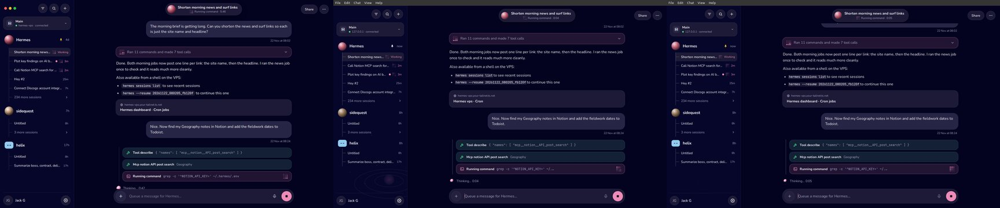
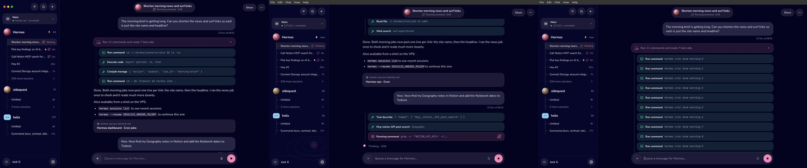
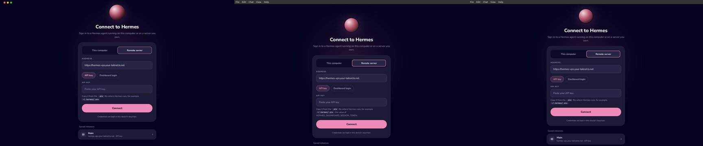
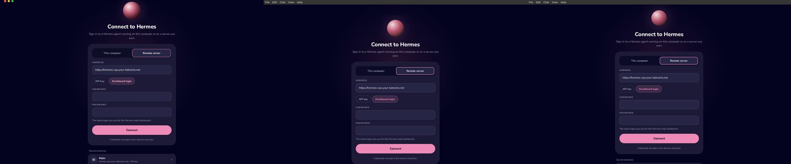
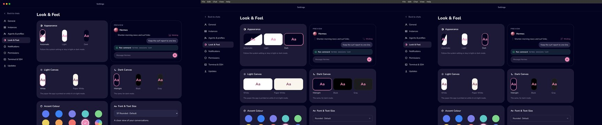

# Design comparison

Each screen of the design export (`design/ref/*.png`, rendered from
`design/*.dc.html`) against the app, screen by screen. The app's shots are
the demo build (`make screenshots`: the real binary on Xvfb, Linux, Midnight
canvas, seeded with the design's data). Strips in `compare/` read
**design | before | after**.

Full-size: `screenshots/before/`, `screenshots/after/` (and
`after/settings-full.png`, the whole Look & Feel page at 1440×1800).

## Differences found and fixed

| Screen | Difference | Fix |
|---|---|---|
| Main | Pin icon drawn white | MyGo tints SVG icons with the text colour; the pin is now drawn in `#F5C542` |
| Main | Transcript ~70 px taller: 18 px between every row | The design's spacing: 18 px between a message and its reply, 10 px between the parts of a reply, 24 px before a later message, 18 px before "Thinking…" and cards |
| Main | Paragraph and list spacing looser | Markdown block spacing 10 px, list items 6 px |
| Main | Link card read "Hermes vps · Cron" | Cards show the page's own title, fetched once in the background (no cookies, 5 s, 256 KB); General → "Load link previews" turns it off |
| Main | Background artwork clearly visible | Fainter orbit lines, no glow; it is a hint behind the list, as the design's empty sidebar suggests |
| Main, expanded | Expanding a group left the list at its end, the group out of sight | The list holds its place when a group opens (`ListState.HoldPlace`) |
| Main | "Thinking…" stayed while the reply streamed | Shown only before the reply starts or while a tool runs |
| Main | Header said "Running command" while a card waited | A pending card reads "Waiting for you" |
| Connect | Content started ~85 px low (a 56 px drag strip took room) | The drag strip overlays the content, which starts 28 px down, as designed; "Saved instances" is on screen again |
| Connect | Extra help text ("…: the value of HERMES_DASHBOARD_SESSION_TOKEN.") | The design's wording; a refused key's error explains the variable instead |
| Settings | Theme tiles were full-width cards | 40 × 84 px pills around their "Aa", as designed |
| Settings | Content 18 px right of the design | Settings nav is 230 px wide |
| Settings | White slider thumb | A drawn slider: thin grey track, accent thumb |
| Settings | Mist loader 5 lacked its outer ring | Ring 7–9 px out, in the accent's tint |
| Settings | Sphere of light 3 drawn off-centre | The gradient now spans the whole sphere, lit from the top left |

## Differences kept, and why

| Difference | Why |
|---|---|
| A menu bar on Linux (and Windows) where the design shows macOS traffic lights | The brief asks for real window menus on Windows and Linux; macOS gets the hidden title bar with the traffic lights over the sidebar |
| The chat opens at its newest turn; the design shows the page scrolled to the top | A chat must show its latest message; the design is a static page (its own last row sits half under the composer) |
| "127.0.0.1 · connected" for "hermes-vps · connected", times such as "now"/"0:04" for "4d"/"5:46", 18 tool pills in the expanded group for 4, row order of two running chats | Demo data from the fake instance, not the UI |
| "Rounded · Default" for "SF Rounded · Default" | SF Rounded exists only on macOS, where the label says so; elsewhere the bundled Nunito is used |
| Inline code chips have less padding than the design's 2 × 7 px | MyGo's Markdown theme sets a code span's background but has no padding or radius for it (v0.10.0) |
| Mist loaders 1–4 slightly sparser | Dots are drawn per pixel grid at the tile's size; within a pixel of the design |
